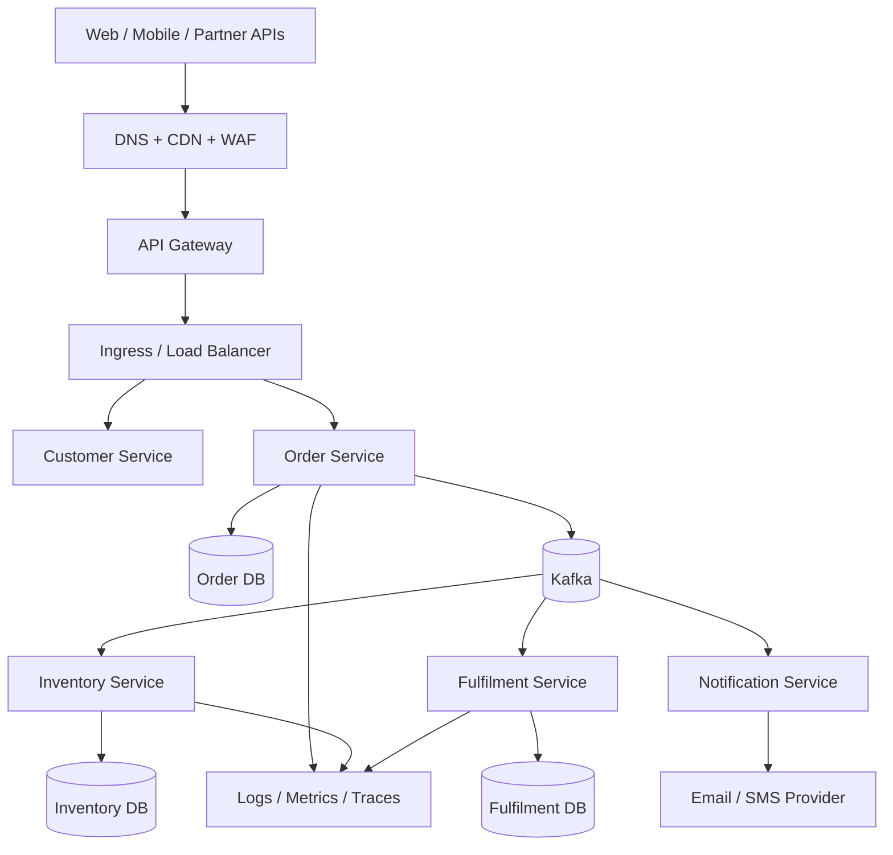

# Enterprise Solution Architect Portfolio
### Designing secure, scalable, resilient and cost-optimized digital platforms

> A reference architecture portfolio demonstrating end-to-end Solution Architecture: business alignment, HLD/LLD, Java microservices, event-driven integration, cloud deployment, security, observability, delivery governance and architecture trade-offs.

## Business problem
A growing product/service organization needs a digital platform to manage customer orders across web, mobile and partner channels. The platform must handle variable demand, integrate inventory and fulfilment capabilities, provide near-real-time order status, and remain secure and available during partial failures.

This is a **reference solution**, not a claim about a production system or measured business outcomes.

## Architecture at a glance

## What this repository demonstrates
- Business capability decomposition and domain boundaries
- HLD, deployment view, sequence flows and API contracts
- Java 17+, Spring Boot, REST APIs and persistence patterns
- Kafka-based asynchronous integration and eventual consistency
- Resilience: timeouts, retries with backoff, circuit breakers, idempotency and DLQs
- Cloud-native deployment, autoscaling, CI/CD and infrastructure as code
- Zero-trust security, secrets management and auditability
- SLOs, observability, performance engineering and cost governance
- Architecture Decision Records (ADRs), risks and delivery governance

## Suggested technology baseline
| Capability | Reference choice | Alternatives |
|---|---|---|
| Services | Java 17/21, Spring Boot | .NET, Node.js, Python |
| API | REST/JSON, OpenAPI | GraphQL, gRPC |
| Messaging | Apache Kafka | RabbitMQ, cloud-native queues |
| Data | PostgreSQL per service | Managed relational / NoSQL where justified |
| Runtime | Kubernetes | ECS, AKS, EKS, OKE, managed container platforms |
| Edge | CDN, WAF, API Gateway | Cloud or enterprise equivalents |
| Observability | OpenTelemetry, Prometheus, Grafana | Managed APM platforms |
| Delivery | GitHub Actions, containers, IaC | Jenkins, GitLab CI, Azure DevOps |

## Non-functional targets (proposed design targets)
- Availability objective: 99.9% monthly for customer-facing order APIs, subject to dependency and operational design.
- Latency objective: p95 under 300 ms for synchronous read APIs under agreed baseline load; asynchronous workflows have separate completion SLOs.
- Security: TLS in transit, encryption at rest, least privilege, managed secrets, audit trails and threat modelling.
- Resilience: no single application instance dependency; multi-zone deployment; graceful degradation for non-critical dependencies.
- Scalability: stateless service replicas, horizontal autoscaling and independently scalable consumers.
- Recovery: define RTO/RPO with business owners; do not assume a universal value.

## Repository map
- [`docs/solution-overview.md`](docs/solution-overview.md): business context and architecture narrative
- [`architecture/high-level-design.md`](architecture/high-level-design.md): HLD and component responsibilities
- [`architecture/low-level-design.md`](architecture/low-level-design.md): service internals and API examples
- [`architecture/security-and-resilience.md`](architecture/security-and-resilience.md): security and failure handling
- [`architecture/observability-and-slos.md`](architecture/observability-and-slos.md): monitoring, alerting and SLOs
- [`architecture/cloud-deployment.md`](architecture/cloud-deployment.md): deployment topology and cloud mapping
- [`adr/`](adr/): architecture decisions and trade-offs
- [`delivery/`](delivery/): CI/CD, quality gates and rollout strategy
- [`interview-narrative.md`](interview-narrative.md): how to present this portfolio to a VP/CTO or interviewer

## How to use this portfolio
1. Replace the sample business assumptions with a target industry (retail, banking, manufacturing, SaaS).
2. Add a diagram exported from draw.io / Structurizr if you want a visual HLD.
3. Implement one vertical slice: create order → publish event → reserve inventory → notify.
4. Add tests, Dockerfiles, deployment manifests and a working CI pipeline before calling it production-ready.

## Architecture principles
Business capability first · loose coupling · high cohesion · secure by design · API and event contracts · automation · observable by default · resilience over blind retries · cost-aware engineering · evolutionary architecture.

---
**Disclaimer:** This is a portfolio reference design. Availability, latency, throughput, RTO/RPO and cost figures must be validated through workload modelling, load tests, cloud pricing and operational readiness reviews.
