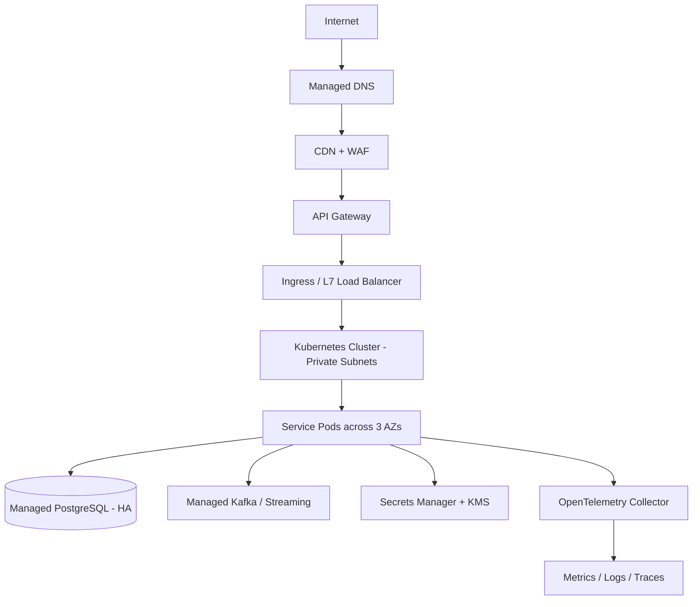

# Cloud Deployment and Platform Mapping

## Reference deployment

## Cloud service equivalents
| Capability | AWS | Azure | OCI |
|---|---|---|---|
| DNS | Route 53 | Azure DNS | OCI DNS |
| CDN / WAF | CloudFront / AWS WAF | Front Door / WAF | CDN / WAF services |
| API management | API Gateway | API Management | API Gateway |
| Load balancing | ALB / NLB | Azure Load Balancer / Application Gateway | OCI Load Balancer |
| Kubernetes | EKS | AKS | OKE |
| Container alternative | ECS | Container Apps | Container Instances |
| Relational DB | RDS / Aurora | Azure Database for PostgreSQL | OCI Database with PostgreSQL / managed DB options |
| Streaming | MSK / Kinesis | Event Hubs | OCI Streaming |
| Secrets / keys | Secrets Manager / KMS | Key Vault | Vault / Key Management |
| Monitoring | CloudWatch / managed partners | Azure Monitor | OCI Monitoring / Logging |

Validate current service features, regional availability, pricing, SLAs and network topology against official provider documentation before selecting.

## Availability design
- Spread stateless replicas across availability zones.
- Use health/readiness probes and disruption budgets.
- Use autoscaling on CPU/memory plus business signals such as request rate and consumer lag.
- Use managed HA database configuration, connection pooling and tested failover.
- Ensure dependencies are not accidentally single-zone bottlenecks.
- Define SLOs and error budgets; 99.9% allows roughly 43.8 minutes of unavailability in a 30.4-day month.

## Cost optimization
1. Right-size from measured CPU, memory, network and database metrics.
2. Scale workers based on queue lag and demand; scale down safely.
3. Use autoscaling with sensible minimum/maximum replicas and stabilization windows.
4. Apply retention and lifecycle policies to logs, events and backups.
5. Use commitments/savings plans only for stable baseline workloads.
6. Optimize data transfer, NAT, cross-zone traffic and observability cardinality.
7. Track unit economics such as infrastructure cost per 1,000 orders.

Do not optimize cloud spend by removing redundancy needed to meet availability or recovery objectives.
