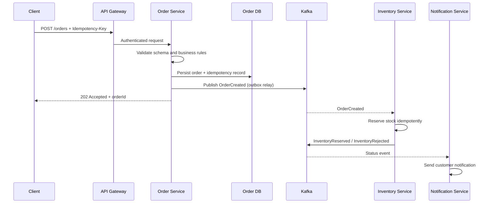

# High-Level Design (HLD)

## Context and flow

## Logical components
| Component | Responsibility | Scaling characteristic |
|---|---|---|
| DNS/CDN/WAF | Domain routing, caching of static content, edge filtering | Managed edge capacity |
| API Gateway | Authentication integration, quotas, routing, API policies | Scale gateway tier independently |
| Order Service | Order validation, lifecycle, idempotency | Stateless replicas; DB capacity is a separate constraint |
| Inventory Service | Stock availability and reservation | Scale consumers by partition/lag and DB capacity |
| Fulfilment Service | Shipment/fulfilment orchestration | Independent service scaling |
| Notification Service | Email/SMS/push integration | Queue-driven workers |
| Kafka | Durable event streaming | Partition, broker and replication planning |
| Service databases | Service-owned persistence | Tune and scale per workload |

## Design choices
- Use synchronous REST for request validation and immediate acknowledgement.
- Use events for long-running workflows and cross-domain notifications.
- Use the transactional outbox pattern to avoid a database-commit/message-publish dual-write gap.
- Use a saga/process manager only when a business workflow requires coordinated steps and compensations.
- Keep service boundaries aligned to business capabilities, not technical layers.

## Consistency
Order acceptance is strongly consistent within the Order Service boundary. Inventory reservation and fulfilment are eventually consistent. The UI should expose meaningful states such as ACCEPTED, INVENTORY_PENDING, CONFIRMED, REJECTED and FULFILLED.
