# Delivery, CI/CD and Architecture Governance

## Pipeline

```mermaid
flowchart LR
  PR[Pull Request] --> BUILD[Compile + Unit Tests]
  BUILD --> QUALITY[Lint + Coverage + SAST]
  QUALITY --> DEP[Dependency / Container Scan]
  DEP --> PACKAGE[Build Immutable Image]
  PACKAGE --> INT[Integration + Contract Tests]
  INT --> STAGE[Deploy to Staging]
  STAGE --> PERF[Smoke + Performance Checks]
  PERF --> APPROVE[Release Approval]
  APPROVE --> PROD[Progressive Production Rollout]
  PROD --> VERIFY[Health + SLO Verification]
  VERIFY -->|Issue| ROLLBACK[Rollback / Roll Forward]
```

## Quality gates
- Code review and architecture/security review for material changes.
- Unit, integration, contract and critical-path end-to-end tests.
- SAST, dependency, secret and container image scanning.
- SBOM and artifact provenance where supported.
- IaC plan review and policy checks.
- Backward-compatible API/event schema validation.
- Production smoke tests, canary/blue-green strategy and rollback criteria.

## Governance artefacts
- Business capability map and context diagram
- HLD / LLD and data-flow diagrams
- ADRs with options, trade-offs and consequences
- Threat model and data classification
- NFR/SLO matrix and capacity assumptions
- API/event contracts and versioning policy
- Operational runbooks, DR plan and support ownership

## Delivery lifecycle
Discover → clarify business outcomes → assess current state → define target architecture → validate options/POCs → approve architecture and risks → implement vertical slices → test NFRs → release progressively → observe and optimize.

Architecture governance should enable teams, not create unnecessary approval queues. Use risk-based review and lightweight guardrails.
